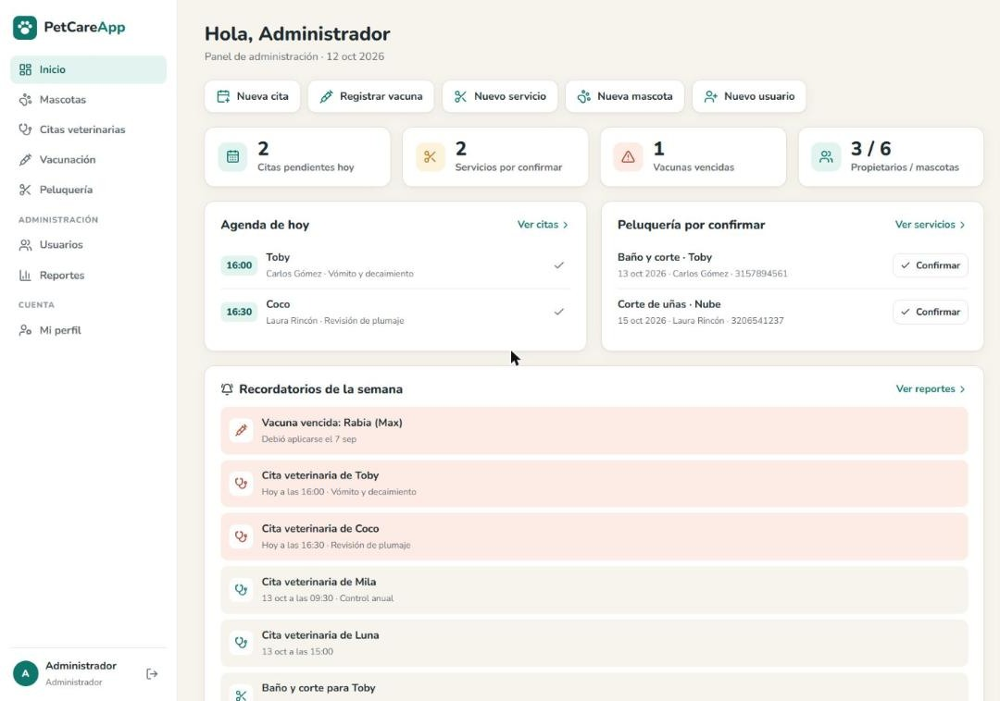
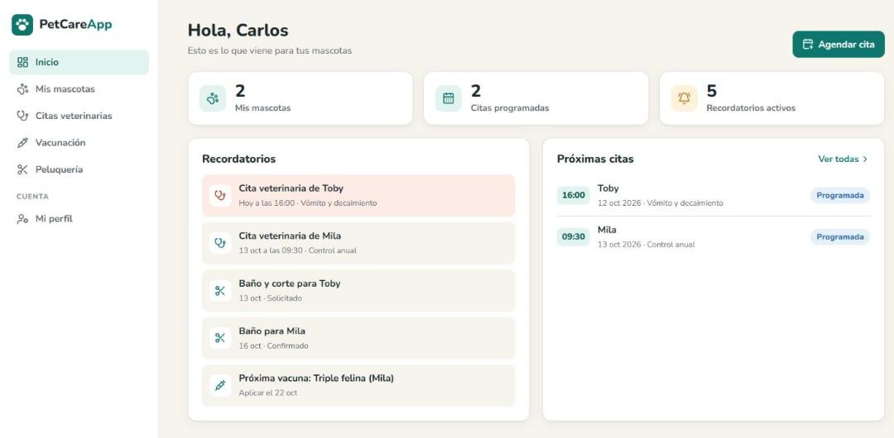
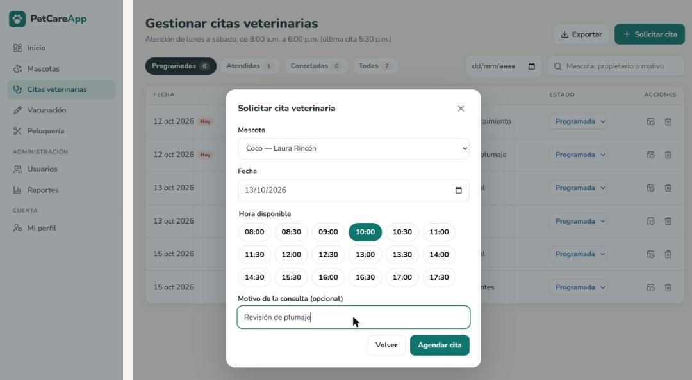
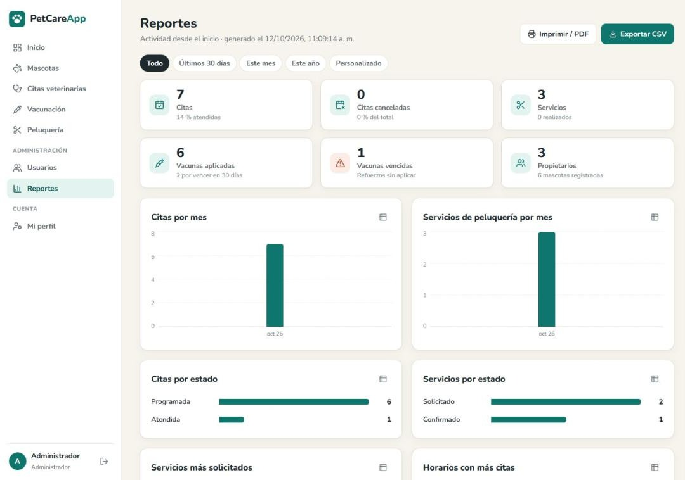
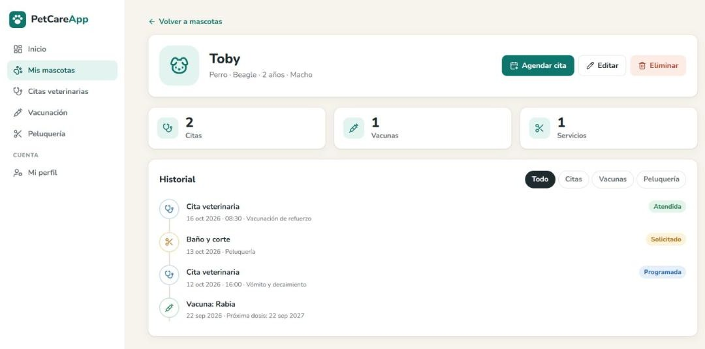

<p align="center">
  
</p>

<h1 align="center">PetCareApp</h1>

<p align="center">
  Plataforma web para la gestión de servicios integrales para mascotas: propietarios y mascotas, citas veterinarias, vacunación, peluquería, recordatorios y reportes.
</p>

<p align="center">
  <a href="https://petcareapp-sgns.onrender.com"><b>Abrir la aplicación</b></a> ·
</p>




---

## Contenido

1. [Aplicación publicada](#1-aplicación-publicada)
2. [Funcionalidades](#2-funcionalidades)
3. [Tecnologías](#3-tecnologías)
4. [Ejecutar en tu computador](#4-ejecutar-en-tu-computador)
5. [Despliegue](#5-despliegue)
6. [Trazabilidad con los requerimientos](#6-trazabilidad-con-los-requerimientos)
7. [Estructura del proyecto](#7-estructura-del-proyecto)
8. [Base de datos](#8-base-de-datos)
9. [Manual de usuario](#9-manual-de-usuario)

---

## 1. Aplicación publicada

**<https://petcareapp-sgns.onrender.com>**

| Rol | Correo | Contraseña |
| --- | --- | --- |
| Administrador | admin@petcareapp.com | Admin123* |

Los propietarios crean su propia cuenta desde la opción **Regístrate** de la pantalla de inicio de sesión.

> El servidor gratuito de Render se suspende tras 15 minutos sin uso: la primera visita después de ese tiempo tarda unos 50 segundos. Los datos no se pierden, porque están en PostgreSQL (Neon).

## 2. Funcionalidades

**Propietario**

- Registro de cuenta, inicio de sesión y edición de su perfil.
- Registro, edición y eliminación de sus mascotas, con historial de citas, vacunas y servicios.
- Solicitud de citas veterinarias viendo solo las horas libres; reprogramación y cancelación.
- Solicitud, modificación y cancelación de servicios de peluquería.
- Consulta del esquema de vacunación con el estado de cada refuerzo.
- Recordatorios de citas y servicios de los próximos 7 días y de vacunas por vencer o vencidas.

**Administrador**

- Panel con la agenda del día, peluquería por confirmar, vacunas vencidas y accesos rápidos.
- Gestión completa de usuarios (crear, editar, cambiar rol, restablecer contraseña y eliminar).
- Gestión de mascotas de cualquier propietario, incluido el cambio de dueño.
- Gestión de citas, vacunas y servicios: crear, modificar, cambiar estado y eliminar.
- Reportes por periodo con indicadores y gráficas, exportación a CSV e impresión a PDF.
- Búsqueda, filtros y exportación a CSV en todas las tablas.

| Inicio del propietario | Solicitud de cita |
| --- | --- |
|  |  |
| **Reportes** | **Historial de una mascota** |
|  |  |

**Reglas de negocio:** atención de lunes a sábado; la primera cita es a las 08:00 y la última a las 17:30, en franjas de 30 minutos. No se permiten dos citas en la misma franja (lo garantiza un índice único en la base de datos, incluso con solicitudes simultáneas), ni fechas u horas que ya pasaron.

**Seguridad (RNF03):** contraseñas cifradas con bcrypt, sesiones con JWT (8 horas), consultas parametrizadas contra inyección SQL y control de acceso por rol. El rol se verifica contra la base de datos en cada petición, así que un cambio de rol o la eliminación de una cuenta aplican de inmediato.

## 3. Tecnologías

| Capa | Tecnología |
| --- | --- |
| Frontend | React 18, React Router, Vite, íconos Lucide |
| Backend | Node.js, Express (API REST) |
| Base de datos | PostgreSQL: Neon en producción, PGlite (PostgreSQL embebido) en local |
| Seguridad | JWT, bcrypt |
| Despliegue | Render (aplicación) + Neon (base de datos) |

## 4. Ejecutar en tu computador

Requisito: [Node.js](https://nodejs.org) 18 o superior. No hace falta instalar PostgreSQL: en local se usa una versión embebida que guarda los datos en la carpeta `data/`.

```cmd
cd %USERPROFILE%\Documents\petcareapp
npm run setup
npm run build
npm start
```

Luego abre <http://localhost:3000>.

- `npm run setup` instala las dependencias del backend y del frontend (solo la primera vez).
- `npm run build` compila el frontend (repítelo cada vez que cambies algo en `client/`).
- `npm start` inicia el servidor.

El administrador `admin@petcareapp.com` / `Admin123*` se crea automáticamente en el primer arranque. Para usar otros datos, copia `.env.example` como `.env` y edita `ADMIN_EMAIL` y `ADMIN_PASSWORD` **antes** de arrancar por primera vez.

**Modo desarrollo** (recarga automática), en dos ventanas de CMD:

```cmd
:: Ventana 1 - backend en http://localhost:3000
npm run dev

:: Ventana 2 - frontend en http://localhost:5173
cd client
npm run dev
```

## 5. Despliegue

La aplicación está desplegada en **Render** (plan gratuito) con la base de datos en **Neon** (PostgreSQL gratuito). Cada `push` a la rama `main` vuelve a desplegarla automáticamente.

Para desplegar una copia nueva:

1. **Base de datos (Neon).** Crea un proyecto en <https://neon.tech> y copia la *connection string* (`postgresql://...`).
2. **Aplicación (Render).** En <https://render.com> elige *New → Blueprint* y selecciona este repositorio; Render lee `render.yaml`. Completa:
   - `DATABASE_URL`: la connection string de Neon.
   - `ADMIN_PASSWORD`: la contraseña del administrador.
3. Al terminar, Render entrega la URL pública. Las tablas y el administrador se crean solos al iniciar; el servidor responde en `/api/salud`.

## 6. Trazabilidad con los requerimientos

| Requerimiento | Caso de uso | Dónde está |
| --- | --- | --- |
| RF01 Registrar propietarios | CU-01 | Pantalla *Registrarse* · `POST /api/auth/registro` |
| RF09 Iniciar sesión | CU-02 | Pantalla *Iniciar sesión* · `POST /api/auth/login` |
| RF02 Registrar mascotas | CU-03 | *Mis mascotas* · `POST /api/mascotas` |
| RF03 Actualizar mascotas | CU-04 | *Mis mascotas → Editar* · `PUT /api/mascotas/:id` |
| RF04 Solicitar citas | CU-05 | *Citas → Solicitar cita* (solo horarios libres) · `POST /api/citas` |
| RF08 Consultar citas | CU-06 | *Citas veterinarias* · `GET /api/citas` |
| RF05 Historial de servicios | CU-07 | *Mis mascotas → Historial* · `GET /api/mascotas/:id` |
| RF06 Registrar vacunaciones | CU-08, CU-14 | *Vacunación* (el administrador registra) · `/api/vacunas` |
| RF10 Solicitar peluquería | CU-09 | *Peluquería* · `POST /api/servicios` |
| RF07 Generar recordatorios | CU-10 | *Inicio → Recordatorios* · `GET /api/recordatorios` |
| RF11 Editar propietario | — | *Mi perfil* · `PUT /api/auth/perfil` |
| RF12 Cancelar cita | — | *Citas → Cancelar* · `PATCH /api/citas/:id/cancelar` |
| Reprogramar cita | — | *Citas → Reprogramar* · `PUT /api/citas/:id` |
| Modificar servicio | — | *Peluquería → Modificar* · `PUT /api/servicios/:id` |
| — | CU-11 Gestionar usuarios | *Usuarios* (crear, editar, cambiar rol, eliminar) · `/api/admin/usuarios` |
| — | CU-12 Gestionar mascotas | *Mascotas* (todas, registro para cualquier propietario y cambio de dueño) |
| — | CU-13 Gestionar citas | *Citas* (crear, reprogramar, cambiar estado y eliminar) |
| — | CU-15 Gestionar servicios | *Peluquería* (crear, modificar, cambiar estado y eliminar) |
| — | CU-16 Generar reportes | *Reportes* (periodo, gráficas, CSV e impresión) · `GET /api/admin/reportes?desde=&hasta=` |

## 7. Estructura del proyecto

```
petcareapp/
├── server/                   Backend (API REST)
│   ├── index.js              Arranque del servidor y manejo de errores
│   ├── db.js                 Conexión a PostgreSQL (Neon) o PostgreSQL embebido
│   ├── schema.sql            Tablas (modelo entidad-relación)
│   ├── utils.js              Validaciones, horarios y fechas
│   ├── middleware/auth.js    Autenticación y roles
│   └── routes/               auth, mascotas, citas, vacunas, servicios, recordatorios, admin
├── client/                   Frontend (React + Vite)
│   └── src/
│       ├── components.jsx    Componentes compartidos (formularios, avisos, confirmaciones)
│       └── pages/            Una pantalla por módulo
├── docs/
│   ├── Manual de usuario - PetCareApp.pdf
│   └── manual/               Fuente del manual, capturas y script para generarlo
├── .env.example              Variables de configuración
└── render.yaml               Configuración de despliegue en Render
```

## 8. Base de datos

Implementa las cinco tablas del modelo entidad-relación de la Entrega 2 (`propietario`, `mascota`, `cita`, `vacuna`, `servicio`) con sus llaves foráneas 1:N. Ajustes de implementación:

- `propietario.rol`: distingue al Propietario del Administrador.
- `mascota.especie`: tipo de animal.
- `cita.motivo`: motivo de la consulta.
- `vacuna.fecha_proxima`: fecha del refuerzo, usada para los recordatorios.
- Índice único `uq_cita_franja` sobre `cita(fecha, hora)` para las citas programadas: impide reservar dos veces la misma franja.

## Autor
Jhanpol Parra Barreto
node docs/manual/construir.mjs
```
